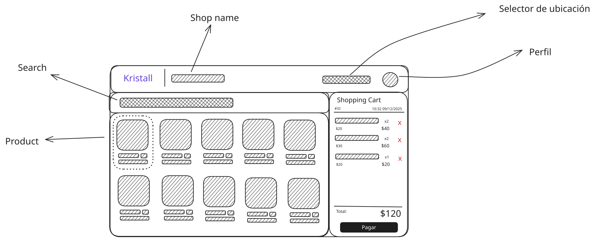

## Getting Started

- Clone the repository
- Run `npm install` or `pnpm install` to install the dependencies
- Run `npm run dev` or `pnpm dev` to start the development server

## Mockup

The mockup for the POS system, this is a rough sketch of the UI. The actual UI may differ from this mockup but this is the general idea of how the UI should look like.

